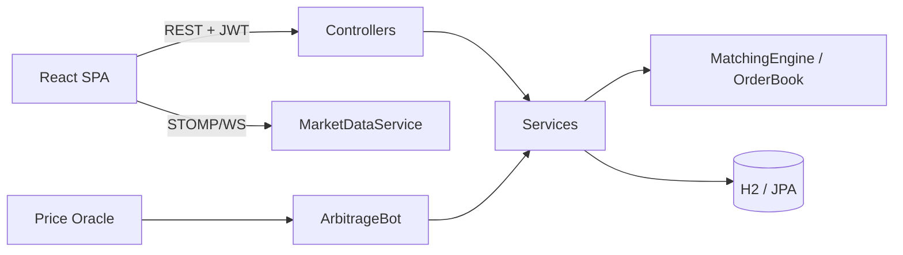

# Crypto Exchange Simulation

Учбова симуляція **централізованої криптобіржі (CEX)**  
Java 21 · Spring Boot 3 · JPA/H2 · React 19 · WebSocket · JWT

> Без реальних грошей і блокчейна. Matching engine, гаманці, комісії, OHLCV і адмінка — у одному репозиторії.

---

## Огляд

| Шар | Технології | Відповідальність |
|-----|------------|------------------|
| **Backend** | Java 21, Spring Boot 3.2, Spring Security, JPA, H2, Virtual Threads | Matching, settlement, auth, market data |
| **Engine** | In-memory `OrderBook` + `MatchingEngine` | LIMIT / MARKET / STOP / TAKE_PROFIT, FIFO, maker/taker fees |
| **Frontend** | React 19, Vite, TypeScript, FSD, Zustand, TradingView Lightweight Charts | Торгівля, портфель, графіки, адмін |
| **Інтеграції** | Market-data client, arbitrage bot | Зовнішні котирування, демо-арбітраж |



---

## Швидкий старт

### Передумови

- JDK **21+**
- Maven **3.9+**
- Node.js **20+** (frontend)
- Локально встановлений [`fin-core-lib`](https://github.com/ursusandwolf/fin-core-lib) (`com.alex.fin:fin-core:0.1.0`) — приватна залежність

```bash
# 1) Domain library (один раз)
git clone https://github.com/ursusandwolf/fin-core-lib.git
cd fin-core-lib && mvn install -DskipTests

# 2) Backend
cd exchange
mvn spring-boot:run

# 3) Frontend
cd frontend
npm install
npm run dev
```

| Сервіс | URL |
|--------|-----|
| API | http://localhost:8080 |
| H2 Console | http://localhost:8080/h2-console |
| SPA | http://localhost:5173 |

**Дефолтний admin:** `ADMIN_USERNAME` / `ADMIN_PASSWORD` (за замовчуванням `admin` / `admin123`).

### Змінні середовища

| Змінна | Призначення | Default |
|--------|-------------|---------|
| `JWT_SECRET` | Підпис JWT | dev-only secret |
| `ADMIN_USERNAME` / `ADMIN_PASSWORD` | Bootstrap admin | `admin` / `admin123` |
| `PASSWORD_RESET_FRONTEND_URL` | Лінк у листі reset | `http://localhost:5173` |
| `MARKET_DATA_BASE_URL` | Зовнішній market-data | `http://market-data-service` |

---

## Можливості

- **Matching:** LIMIT, MARKET (зі slippage `priceLimit`), STOP_LOSS, TAKE_PROFIT, OCO
- **Гаманці:** резерв під ордери, maker/taker fees → `SYSTEM_FEES`, audit log
- **Consistency:** lock по символу **поза** транзакцією + `TransactionTemplate` + sync стакана `afterCommit` + `@Version`
- **Auth:** JWT + BCrypt, password reset (one-time token), rate limit на auth, ролі USER/ADMIN
- **Realtime:** OrderBook, trades, свічки через WebSocket
- **Charts:** TradingView UDF endpoints + Lightweight Charts

---

## API (коротко)

| Група | Приклади |
|-------|----------|
| Auth | `POST /api/auth/register`, `/login`, `/password-reset/*` |
| Orders | `POST /api/orders/submit`, `/oco`, `POST /api/orders/{id}/cancel` |
| User | `GET /api/user/portfolio`, `/history` |
| Admin | `GET /api/admin/stats`, `/users`, `PATCH .../admin` |
| Market | candles, TradingView UDF, public market data |

Повний опис: [doc/DOCUMENTATION.md](doc/DOCUMENTATION.md) · безпека: [doc/SECURITY.md](doc/SECURITY.md)

---

## Документація

| Документ | Зміст |
|----------|--------|
| [doc/ARCHITECTURE.md](doc/ARCHITECTURE.md) | Шари, concurrency, lifecycle ордера |
| [doc/UML.md](doc/UML.md) | UML класів і послідовностей (Mermaid) |
| [doc/DOCUMENTATION.md](doc/DOCUMENTATION.md) | Сервіси, API, frontend FSD |
| [doc/SECURITY.md](doc/SECURITY.md) | JWT, ролі, rate limit, threat model |
| [doc/REVIEW.md](doc/REVIEW.md) | Чеклист для код-рев’ю |
| [TODO.md](TODO.md) | Roadmap / що вже зроблено |

---

## Структура репозиторію

```
exchange/
├── src/main/java/com/exchange/
│   ├── controller/     # REST
│   ├── service/        # Бізнес-логіка
│   ├── engine/         # MatchingEngine, OrderBook, MatchResult
│   ├── model/          # JPA entities
│   ├── dto/ · mapper/ · repository/ · config/ · client/
├── src/test/java/      # Unit + integration (~20 тест-класів)
├── frontend/           # React FSD (Vite)
└── doc/                # Архітектура, UML, security, review
```

---

## Тести

```bash
mvn test
cd frontend && npm run lint
```

Критичні сценарії: matching, OCO, wallet reserve/settle, auth/reset, controllers (MockMvc).

---

## Гілки

| Гілка | Статус |
|-------|--------|
| `main` | Актуальний код для рев’ю |
| `dev` | Робоча історія розробки (синхрон з main) |
| `feature/start` | Архів першого прототипу (in-memory demo) |

---

## Ліцензія

Учбовий portfolio-проєкт. Вільне використання з зазначенням авторства.
