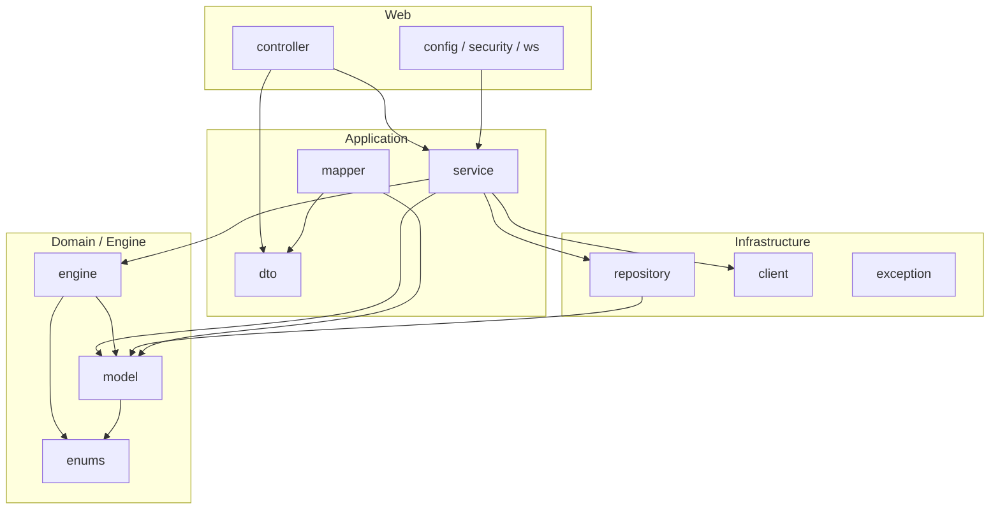
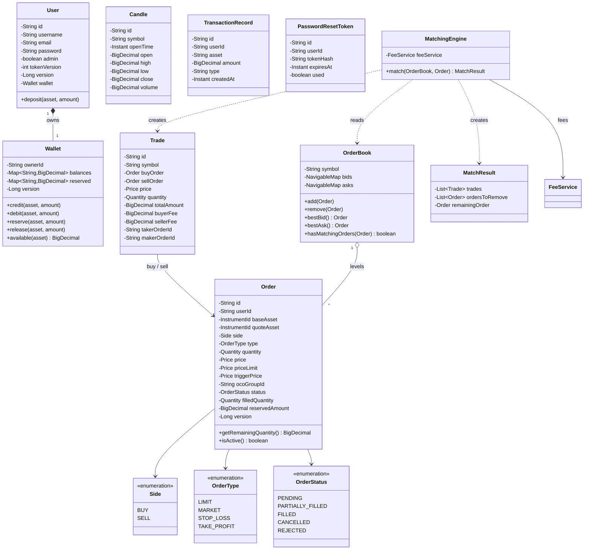
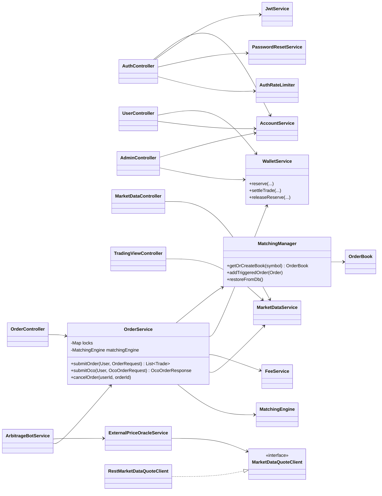
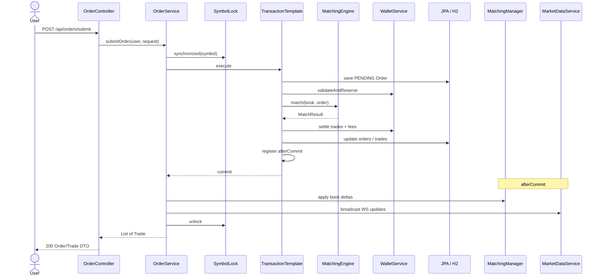
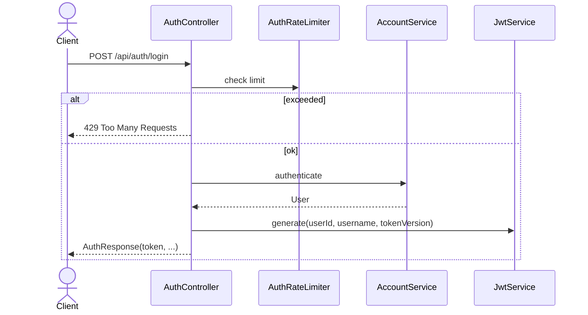
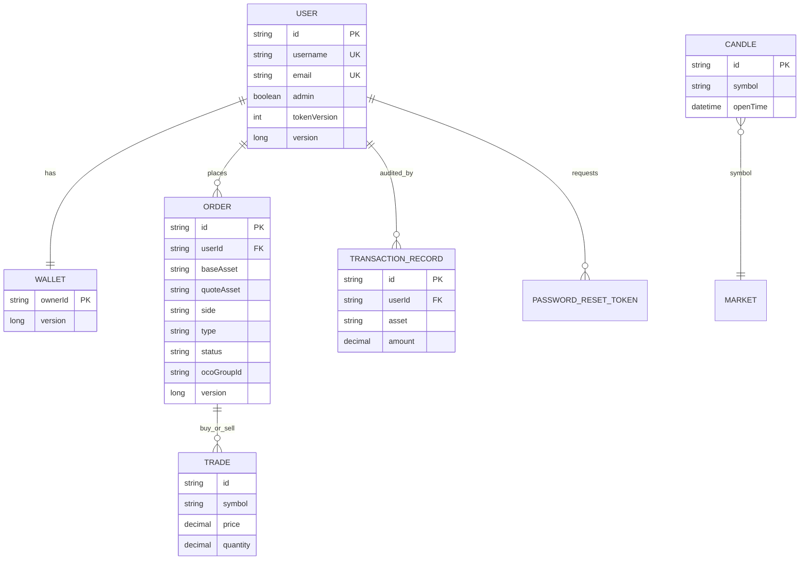

# UML: Crypto Exchange Simulation

Діаграми відповідають коду на гілці `main` (`com.exchange.*`).  
Рендер: GitHub / будь-який Mermaid viewer.

---

## 1. Пакетна структура (логічні модулі)

---

## 2. Діаграма класів — Domain & Engine

---

## 3. Діаграма класів — Services & Controllers

---

## 4. Sequence — Submit LIMIT / MARKET

---

## 5. Sequence — Auth + JWT

---

## 6. ER (спрощено)

---

## Примітки для рев’юера

1. `MatchingEngine` **не** мутує `OrderBook` напряму — лише рахує `MatchResult`.
2. Застосування дельт стакана — у `afterCommit`, щоб пам’ять = БД після успішного коміту.
3. Грошові типи `Price` / `Quantity` / `InstrumentId` — з `fin-core` (`com.alex.fin`), JPA через `AttributeConverter`.
